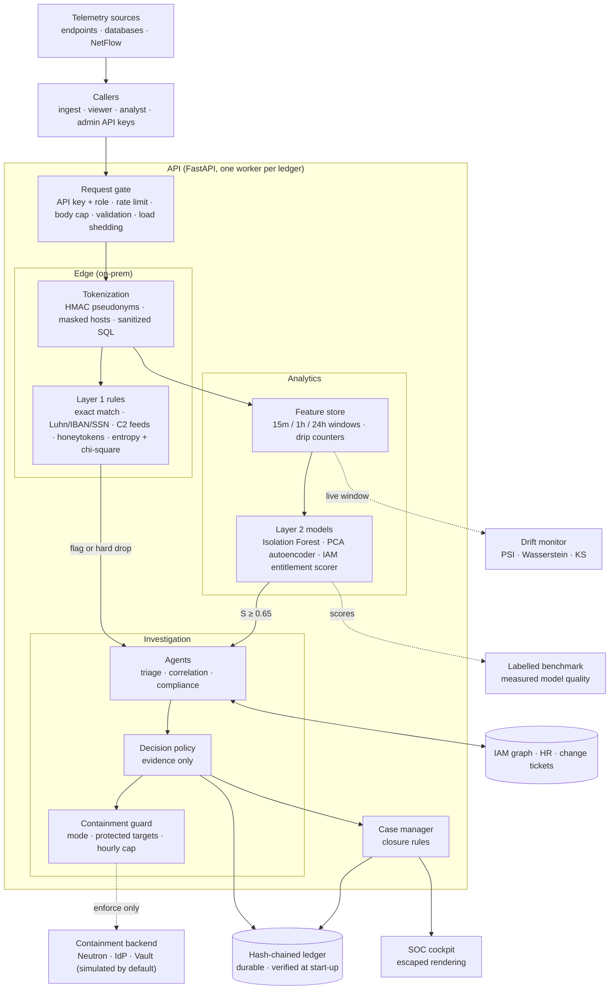
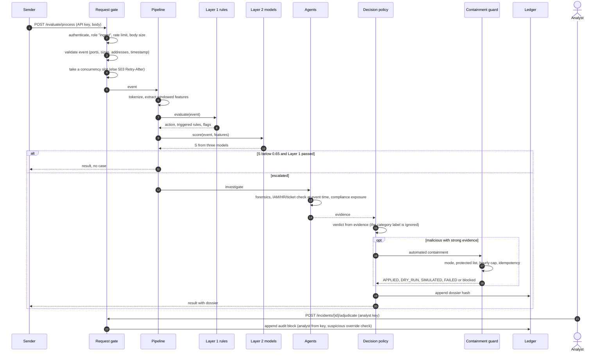
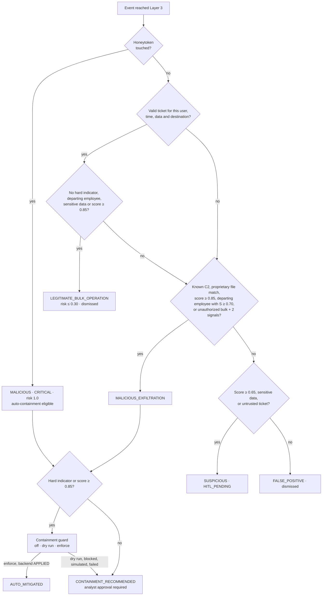
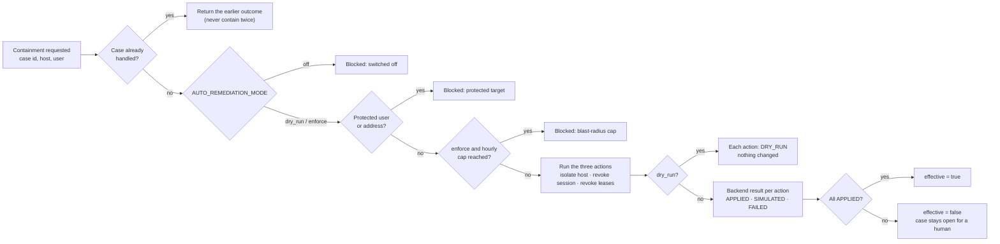

# Sentinel Exfiltration: diagrams (Mermaid)

Paste each block into https://mermaid.live (or any Mermaid viewer) and export PNG or SVG for Medium.

## 1. Architecture

## 2. One event, end to end

## 3. Decision policy

## 4. Containment guard

